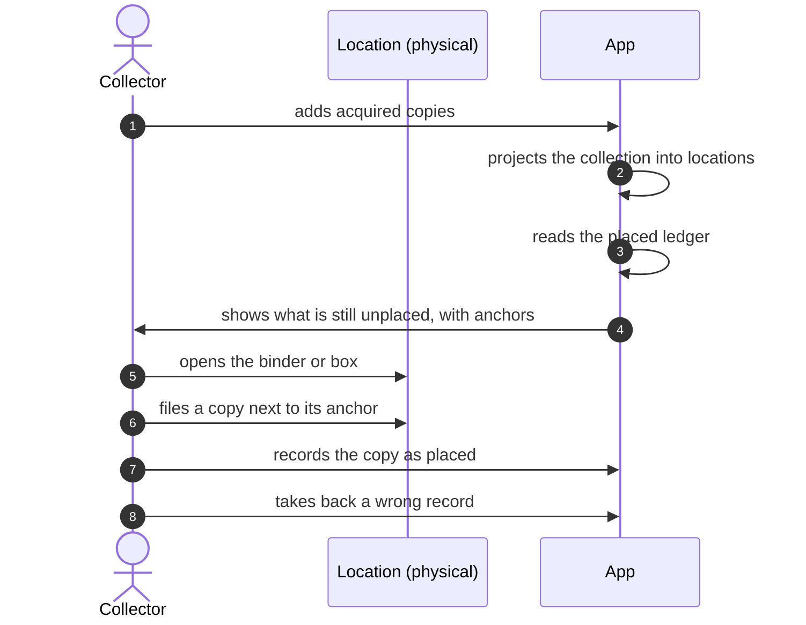
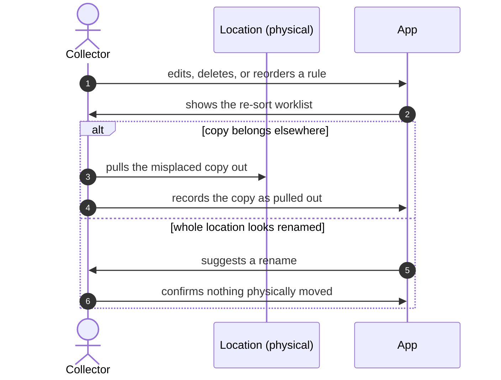
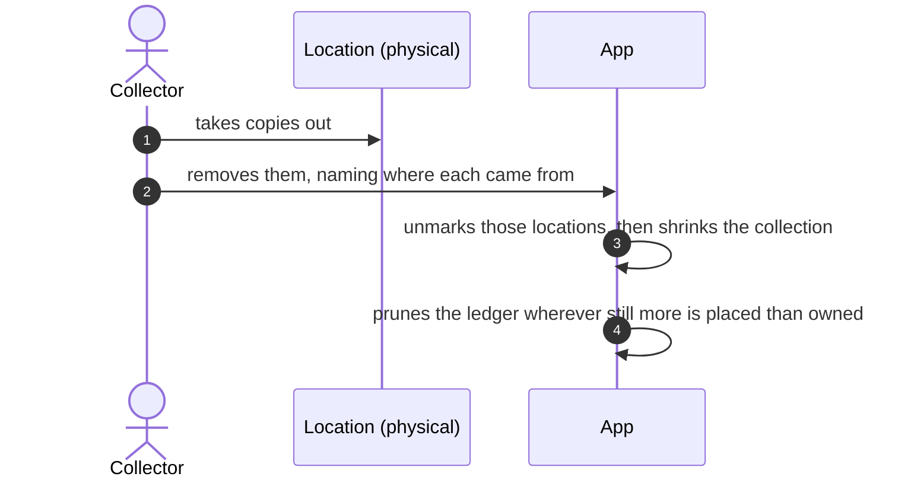
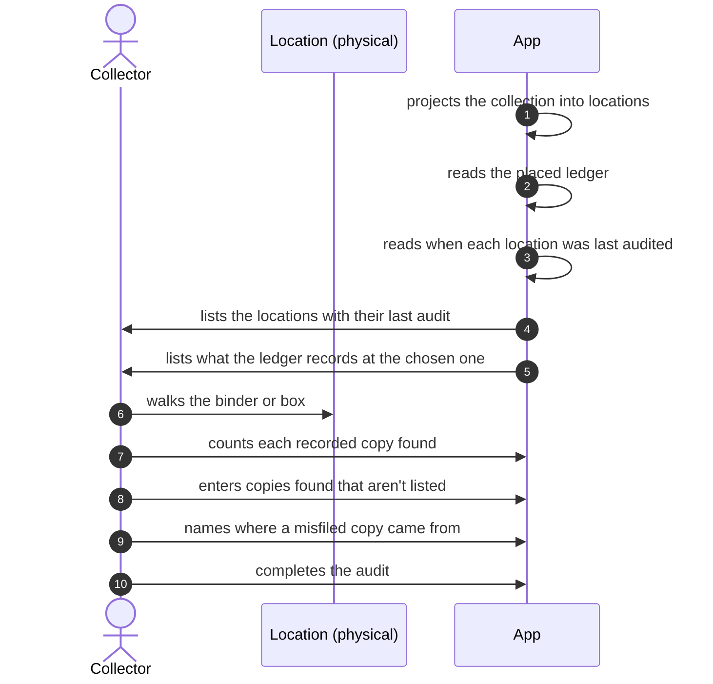

# Filing Cards

*As-is · fine-grained · digitalized.* Goal: the copies physically in each location
match what the placed ledger records there, and both match the projection.

Actors: **Collector**, **App**. Work objects: copy, collection, location (a physical
binder or box), projection, placed ledger, placement guidance, re-sort worklist.

Precondition: the Collector has rules and a bulk spec (story *Designing the sorting
scheme* — not yet written).

## 1. Filing newly acquired copies

1. The Collector adds acquired copies to the collection. [cmd: collection/add_cards]
2. The App projects the collection through the rule cascade into locations.
   [query: inventory_planning/projection]
3. The App reads the placed ledger. [query: inventory_planning/placed_ledger]
4. The App derives placement guidance: per location, the copies still unplaced, each
   with its nearest already-placed neighbours as physical anchors.
   [derived: client-web/src/data/placement/guidance.ts]
5. The Collector picks a location and opens the physical binder or box.
6. The Collector files a copy next to its anchor.
7. The Collector records the copy as placed — singly, or a whole filed stretch at
   once. [cmd: inventory_planning/mark_cards_placed]
8. The Collector notices a wrong record and takes it back — singly, or a whole stretch
   at once. [cmd: inventory_planning/unmark_cards_placed]

Story 4 checks a location's contents against the ledger after the fact.

## 2. Re-sorting after the rules changed

1. The Collector edits, deletes, or reorders a rule.
   [cmd: inventory_planning/upsert_rule] [cmd: inventory_planning/delete_rule]
   [cmd: inventory_planning/reorder_rules]

> **Gap:** the App does not warn that the change strands already-placed copies; the
> Collector finds out afterwards in step 2. [#124](https://github.com/NicoVIII/tcg-card-collector/issues/124)

2. The App re-projects and derives the re-sort worklist: Misplaced copies grouped by
   their stale location, each with the locations where it is now Unplaced.
   [derived: client-web/src/data/placement/resort.ts]
3. The Collector pulls a misplaced copy out of its stale location.
4. The Collector records it as pulled out; the App forgets that placement, so the copy
   re-enters guidance for its new location (story 1, step 4).
   [cmd: inventory_planning/unmark_cards_placed]

Alternatively, when a whole stale location vanished and all its copies share one
destination:

5. The App suggests a rename.
6. The Collector confirms nothing physically moved; the App re-points the location's
   ledger rows. [cmd: inventory_planning/relocate_placed_cards]

## 3. Copies leave the collection

1. The Collector takes copies out of their locations (sold, traded, moved to a deck).
2. The Collector stages the copies to remove; where a copy could have come from more than
   one place, the App lists the locations the ledger records it in (and the unplaced
   ones) and the Collector picks where each was taken from. [query: inventory_planning/placed_ledger]
3. The App unmarks the picked locations, then removes the copies from the collection.
   [cmd: inventory_planning/unmark_cards_placed] [cmd: collection/remove_cards]
4. The collection announces it changed; the App prunes the ledger wherever more copies
   are still placed than owned. [cmd: inventory_planning/reconcile_placed_ledger]

Restoring a backup replaces the collection without steps 2–3, so step 4 prunes by a fixed
location order instead ([ADR 0023](../../decisions/0023-removal-names-the-location.md)).
The App lists the ledger rows it will prune, with their locations, before the Collector
confirms the restore and again after it, so the Collector can check those locations.
[query: inventory_planning/predict_restore_prune] [cmd: portability/import_data]

## 4. Auditing a location

1. The App projects the collection through the rule cascade into locations.
   [query: inventory_planning/projection]
2. The App reads the placed ledger. [query: inventory_planning/placed_ledger]
3. The App reads when each location was last audited.
   [query: inventory_planning/list_location_audits]
4. The App lists every location with its last audit, including ones only the ledger
   still records. [derived: client-web/src/data/location_audit/audit_list.ts]
5. The App lists what the ledger records at the chosen location, in its physical
   order. [derived: client-web/src/data/location_audit/audit_list.ts]
6. The Collector walks the physical binder or box.
7. The Collector counts how many of each recorded copy are there.
   [derived: client-web/src/data/location_audit/audit_session.ts]
8. The Collector enters copies found that the ledger doesn't record there. A copy the
   collection doesn't own is only reported.
   [derived: client-web/src/data/location_audit/audit_session.ts]
9. When every owned copy of a found card is already recorded somewhere, the Collector
   names the location it was misfiled from.
   [derived: client-web/src/data/location_audit/audit_session.ts]
10. The Collector completes the audit. The App unmarks the copies not found, so they
    reappear in placement guidance, marks or moves the found ones here, and records the
    audit ([ADR 0024](../../decisions/0024-location-audit-completes-atomically.md)).
    [cmd: inventory_planning/complete_location_audit]

Abandoning the walk changes nothing.

## Coverage

Inventory Planning handlers referenced: `mark_cards_placed`, `unmark_cards_placed`,
`relocate_placed_cards`, `reconcile_placed_ledger`, `complete_location_audit`,
`upsert_rule`, `delete_rule`, `reorder_rules`, `projection`, `placed_ledger`,
`list_location_audits`.

Owed by other stories: `list_rules`, `get_bulk_spec`, `update_bulk_spec`
(*Designing the sorting scheme*), `restore_plan` (*Backing up and restoring*).
